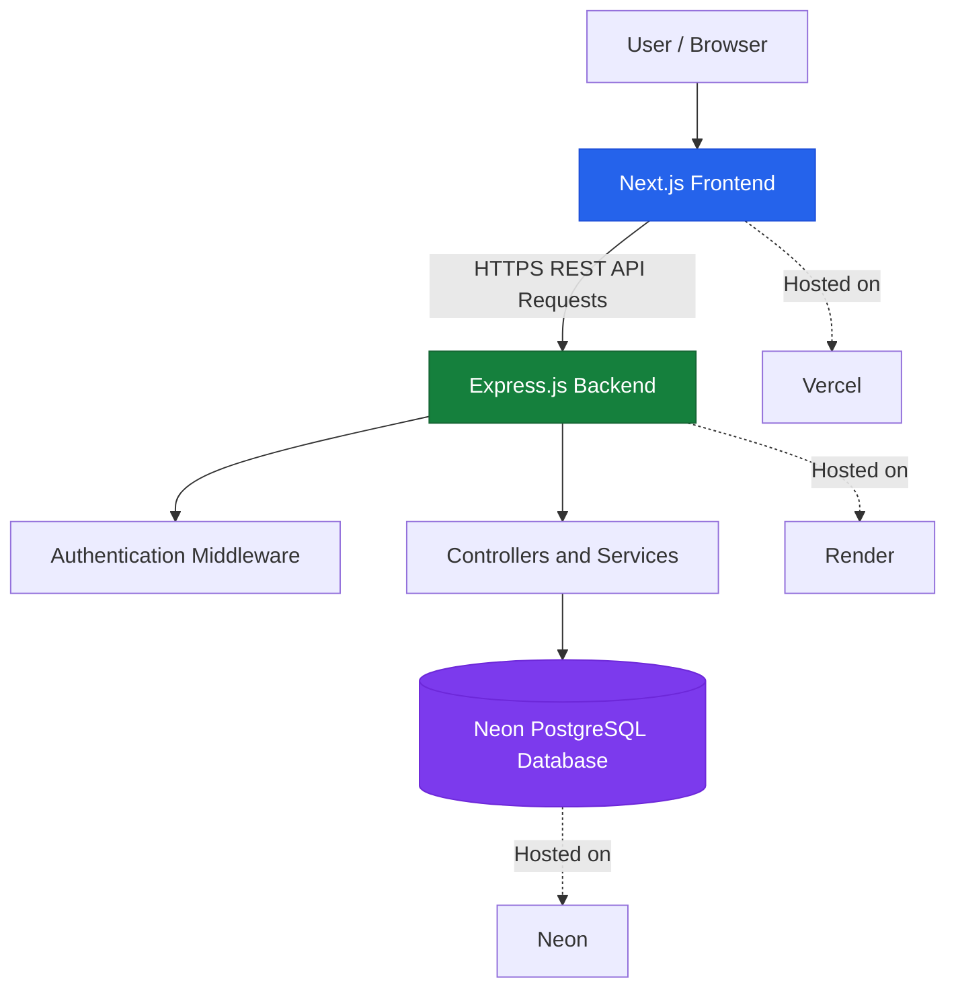

# 🛍️ ShopSphere — Full-Stack E-Commerce Platform

## 🌐 Live Demo

🚀 **Explore the application:** [ShopSphere Live Website](https://shop-sphere-bice-one.vercel.app/)

## 📌 About the Project

ShopSphere is a full-stack e-commerce web application that enables users to explore products, search and filter listings, manage their shopping cart and wishlist, authenticate securely, and access order-related features.

The application follows a client-server architecture using Next.js, Express.js, and PostgreSQL, with the frontend and backend deployed separately.

## ✨ Key Features

- 🔐 User registration and login
- 🛍️ Product browsing and category navigation
- 🔎 Product search, filtering, and sorting
- 🛒 Shopping cart management
- ❤️ Wishlist functionality
- 📍 Delivery address management
- 📦 Order management
- 💳 Payment workflow
- 🛠️ Admin product and customer management
- 🤖 AI-related backend functionality
- 📱 Responsive user interface

## 🏗️ System Architecture

## 🛠️ Tech Stack

| Technology | Purpose |
|---|---|
| Next.js | Frontend framework |
| React | User interface |
| TypeScript | Type-safe development |
| Tailwind CSS | Responsive styling |
| Node.js | Backend runtime |
| Express.js | REST API development |
| PostgreSQL | Relational database |
| Neon | Hosted PostgreSQL |
| JWT | Authentication |
| bcrypt | Password hashing |
| Vercel | Frontend deployment |
| Render | Backend deployment |
| Git & GitHub | Version control |

## 🔒 Security

- Password hashing using bcrypt
- JWT-based authentication
- HTTP-only authentication cookies
- CORS configuration for approved frontend origins
- Environment variables for sensitive configuration

## ☁️ Deployment

| Component | Platform |
|---|---|
| Frontend | [Vercel](https://vercel.com/) |
| Backend | [Render](https://render.com/) |
| Database | [Neon](https://neon.tech/) |

## 👨‍💻 Author

**Sai Chakri Edubilli**

- GitHub: [@saichakri1122](https://github.com/saichakri1122)

---

⭐ If you find this project interesting, consider giving the repository a star!
